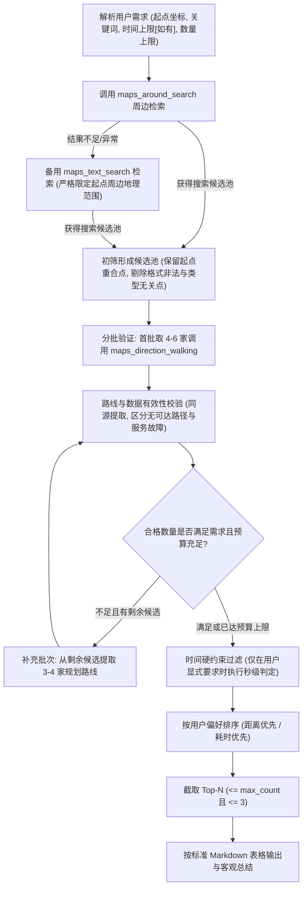

# 周边去哪儿 — 高德地图高保真地点推荐规范

本 Skill 指导评测 Agent 使用高德开放平台 MCP 工具，完成高精度、零幻觉、硬性约束严格可信的周边地点发现与路线核验推荐。

---

## 一、核心原则（最高优先级）

1. **绝对真实性（P0）**：严禁伪造 POI、地址、经纬度、步行距离或步行耗时。所有推荐数据必须来自本次高德 MCP 工具实际调用返回。
2. **强制真实路线规划（P0）**：必须使用 `maps_direction_walking` 获取真实步行路线。严禁使用直线距离、`maps_distance`、经纬度欧氏估算或固定配速推算。严格校验路线有效性，且同一地点的距离与耗时必须提取自同一条规划路径，严禁混用。
3. **区分硬约束与探索范围（P0）**：仅在用户**明确提出时间限制**时执行硬过滤。比对必须基于原始返回秒数：上限 15 分钟（900 秒）时，**900 秒允许，901 秒坚决剔除**。**若用户未明确提出时间上限，严禁私自施加 900 秒硬过滤**；搜索半径仅作为候选发现的地理初筛范围，不得作为用户的硬性时间约束。
4. **数量硬约束（P0）**：默认最多推荐 3 家；用户显式要求少于 3 家时，严格以用户要求为上限；符合条件的有效地点不足时如实返回实际数量，绝不强行凑数。
5. **分批验证与证据求真（P1）**：采用分批核验与调用预算收敛机制，未经验证的候选不得断言其不合格；推荐理由仅陈述由接口数据支撑的客观事实（地点类别符合需求、距离最近、用时最短），软性偏好未核实时必须明确标注“未核实”，严禁使用“高德认证”等无依据虚假背书。

---

## 二、需求解析规则

从用户自然语言输入中提取以下结构化要素：

| 要素 | 说明 | 解析示例与默认处理准则 |
| :--- | :--- | :--- |
| **城市** (`city`) | 用户所在城市名称 | 如“杭州”、“北京” |
| **起点坐标** (`origin`) | 用户明确提供的起点经纬度 | 格式为 `"经度,纬度"`（如 `"120.153576,30.287459"`） |
| **目标类别** (`keywords`) | 想要前往的地点类型 | 如“咖啡馆”、“快餐”、“便利店”、“药店” |
| **步行时间上限** (`max_seconds`) | 用户明确设定的最长步行耗时 | **用户明确提出**（如“15分钟内”）：转为精确秒数（$15 \times 60 = 900$ 秒）； **用户未明确提出时**：设为无硬性时间限制（`None`），**绝对禁止自动强加 900 秒限制** |
| **推荐数量上限** (`max_count`) | 用户要求返回的最多地点数 | “最多2家” $\rightarrow 2$；默认 3，任何情况下 $\le 3$ |
| **排序偏好** (`sort_preference`) | 优先考虑的排序维度 | “优先近一点” $\rightarrow$ 真实路线距离升序；“尽量快到” $\rightarrow$ 真实路线耗时升序；默认耗时与距离综合优先 |
| **软性偏好** (`soft_preferences`) | 环境、价格、氛围、状态等要求 | 如“安静”、“适合办公”、“好停车”、“当前营业” $\rightarrow$ 标记为待核验项 |

---

## 三、高德 MCP 工具调用规程

严格按照以下流水线执行，严禁跨过工具直接生成推荐：

### 步骤 1：地点搜索（POI 发现）

1. **首选工具：`maps_around_search`**
   - `location`: 起点经纬度字符串 `"经度,纬度"`（必填）
   - `keywords`: 目标地点类型（必填）
   - `radius`: 搜索半径（米）。基于场景合理设定候选发现范围：用户明确要求 15 分钟步行时，通常设定 `radius: 1500`；**若用户未明确指定时间上限，设定默认周边探索半径 `radius: 1500` 至 `2000` 米**，该半径仅用于发现周边候选，严禁当作后续硬性时间过滤的依据。
2. **备用工具：`maps_text_search`**
   - 仅在 `maps_around_search` 返回为空、异常、或候选数量严重不足时调用。
   - `keywords`: 关键词
   - `city`: 用户指定的目标城市
   - **防跨区防偏航机制**：`maps_text_search` 为全市范围检索，返回结果可能跨区甚至远离数十公里。**必须首先计算或比对候选 POI 经纬度与起点的相对距离，主动剔除远离起点的异地区域 POI（如直线距离超出 2500~3000 米）**，确保所有进入路线规划的地点确属起点周边，防止荒谬的跨区域推荐。

### 步骤 2：候选初筛与分批验证机制

从搜索结果中整理候选池，并执行受控的分批验证：
1. **初筛过滤规则**：
   - 剔除经纬度格式非法、坐标缺失、或数据结构损坏的异常点。
   - **不要剔除与起点坐标相同的 POI**：若用户就在商厦内部或紧邻目标地点，坐标相同或极近属正常物理现实；只要 POI 真实存在且符合目标类别，正常保留。若真实步行路线返回 0 米 / 极短距离及 0 秒 / 极短耗时，属于有效合规结果。
   - 剔除名称或类型与目标需求明显背离的无关点。
2. **分批验证机制（Batch Verification）**：
   - **首批验证（Batch 1）**：优先选取与起点直观距离或相对距离最近的 **4 至 6 个** 候选 POI，进入步行路线规划。
   - **动态补充（Batch 2）**：若首批候选经路线核验与硬约束过滤后，合格数量仍未达到用户期望数量（默认 3 家或用户指定数），且搜索结果池中仍有未验证候选，按顺序提取下一批（**3 至 4 个**）继续调用规划。
   - **调用预算上限（Budget Cap）**：为防止高频无效调用与接口超时，设置全流程路线规划调用上限（总计规划次数建议不超过 **10 至 12 次**，最多补充 1 批）。
   - **核验定性铁律**：**严禁对未验证的地点断言其“不合格”**。因达到调用预算或已满足数量而未进一步验证的地点，仅定性为“未执行路线验证”，绝不得主观臆断其超标或无效。

### 步骤 3：真实步行路线核验与数据严格处理

对各批次选出的候选 POI，**分别独立调用一次** `maps_direction_walking`：
- `origin`: 用户起点经纬度 `"经度,纬度"`（必须与用户输入完全一致，所有候选必须使用同一起点，严禁多站串联）。
- `destination`: 当前候选 POI 的经纬度 `"经度,纬度"`。
- **数据提取与同源校验**：
  1. 检查返回结果中是否存在有效路径列表（`route.paths` 或 `paths` 非空）。
  2. 提取第一条/最优路径中的 `distance`（米）与 `duration`（秒），并转换为有效数值。
  3. **数据同源性保证**：`distance` 和 `duration` **必须严格提取自同一条规划路径**，绝对严禁将路径 A 的距离与路径 B 的时间混搭拼接。
- **严格区分“无可达路径”与“服务故障”**：
  - **无可达路径（Path Unreachable）**：接口正常响应，但 `paths` 为空或提示无可通行步行道路（如存在物理隔断、跨海无步道等）。此情况判定该地点在物理上无法步行抵达，**直接剔除该候选点**，不得谎报为接口故障。
  - **服务故障（Service Failure）**：MCP 工具报错、HTTP 错误、网络超时或返回报文不可解析。判定为工具调用故障，记录异常状态。

### 步骤 4：硬约束过滤与排序

1. **硬约束过滤**：
   - **若用户明确提出了步行时间上限** $max\_seconds$：提取真实路线规划耗时 $T_{\text{seconds}}$，执行严格秒级比对：$T_{\text{seconds}} \le \text{max\_seconds}$（如 900 秒上限，$\le 900$ 秒保留，$\ge 901$ 秒坚决剔除）。
   - **若用户未明确提出步行时间上限**：**不执行时间硬过滤**，保留所有成功获取有效步行路线的候选地点。
2. **偏好排序**：
   - **距离优先（“近一点”）**：按 `distance`（米）升序；若距离相同，按 `duration`（秒）升序。
   - **时间优先（“快一点 / 尽量快到”）**：按 `duration`（秒）升序；若耗时相同，按 `distance`（米）升序。
   - **默认排序**：按 `duration` 升序为主，`distance` 升序为辅。
3. **数量截取**：
   - 截取排序后的前 $N$ 个结果，其中 $N = \min(\text{合格地点数}, \text{用户要求上限}, 3)$。

### 步骤 5：推荐理由组织（拒绝虚假修饰）

- 仅陈述高德接口真实返回支持的客观事实：
  - 类别匹配：“地点类别符合需求（高德 POI 类型标注包含咖啡厅/饮品店）”
  - 距离优势：“在已验证的候选地点中步行距离最近（约 380 米）”
  - 时间优势：“预计步行仅需 6 分钟，出行最便捷”
  - 极近/重合说明：“与起点位于同一建筑或紧邻区域，步行即达”
- **删除无依据背书**：严禁使用“高德认证咖啡馆”、“官方权威推荐”等脱离接口字段的编造措辞。
- **软性偏好声明**：若用户要求“安静”、“适合办公”、“当前营业”等软偏好，但高德接口字段未提供确凿依据，统一在推荐理由后标注：“（环境安静度/营业状态未核实，高德基础数据未包含该字段）”。

---

## 四、回答输出规范

### 1. 标准输出格式（Markdown 表格）

推荐结果必须以如下结构清晰呈现：

| 地点 | 地址 | 步行距离 | 步行时间 | 推荐理由 |
| :--- | :--- | :--- | :--- | :--- |
| [POI 官方名称] | [POI 详细地址] | [格式化距离] | [格式化耗时] | [基于真实数据的客观推荐依据；未核实偏好注明未核实] |

**格式化示例**：
- 步行距离：`0米`、`80米`、`420米`、`1.1公里`（1000米以上可写作公里或保持米）。
- 步行时间：`0分钟`、`1分钟`、`6分钟`、`12分钟`、`14分30秒`。
- 表格后可附 1 句简要客观的总结建议（如：“综合距离与耗时，在已核验候选中首选推荐【XX咖啡】，步行距离最近且耗时最短。”）。
- 禁止输出 Agent 内部思考日志、调试信息或未经格式化的原始 JSON 块。

---

## 五、异常与边界场景处理协议

必须严格区分“当前已验证候选不足”、“已验证候选均不合格”和“工具调用失败”，严禁在未经证实的情况下断言周边全部情况：

| 场景代码 | 场景类型 | 判定条件 | 处理协议与回答标准 |
| :--- | :--- | :--- | :--- |
| **CASE-A** | **已验证候选不足目标数量** | 经初筛与分批验证后，合格 POI 少于用户要求（如仅 1 或 2 家） | **仅展示合格的 1 或 2 家，严禁凑数**。在表格下方说明：“注：在当前检索并完成真实步行路线验证的周边候选地点中，仅有 X 家符合【目标类别】及步行时间要求，已如实呈现。受限于验证批次与调用预算，其余未验证候选不作主观断言。”（**严禁断言“附近只有X家”或“已全部列出”**）。 |
| **CASE-B** | **已验证候选均超出时间限制** | 用户明确指定时间上限，但所有已验证候选均超时 | **绝不将超时地点作为合格推荐列入表格**。明确告知用户：“在当前检索并完成路线验证的候选地点中，所有地点的步行耗时均超出设定的 Y 分钟上限（其中已验证耗时最短的【地点名】步行约需 Z 分钟）。建议适当放宽步行时间限制或扩大搜索范围。” |
| **CASE-C** | **搜索工具故障** | `around_search` 与 `text_search` 均调用失败或报错 | 如实告知用户：“高德地图地点检索服务暂不可用，无法获取真实周边地点信息，建议稍后重试。”（**严格区分“无地点”与“接口故障”，不混为一谈**）。 |
| **CASE-D** | **步行规划服务故障** | `maps_direction_walking` 接口调用报错或网络故障 | 若个别地点报错则丢弃该点；若全部候选规划均调用故障，如实说明：“高德步行路线规划服务响应异常，无法获取可信路线数据，禁止使用估算，已终止推荐流程。”（**严格区分“无可达步行道路”与“接口服务故障”**）。 |
| **CASE-E** | **无可达步行路径** | 接口正常响应，但结果明确指示无可行步行道路 | 判定该候选点在物理上步行不可达，从推荐池剔除，不混淆为服务报错。 |
| **CASE-F** | **不可核验软偏好** | 用户要求“安静/适合办公/不排队/优惠” | 正常推荐符合步行时间硬约束的地点，在推荐理由中如实注明：“（安静程度/办公适宜度未核实）”，不凭空臆造。 |
| **CASE-G** | **数据冲突或缺失** | POI 地址为空、跨城或坐标异常 | 丢弃数据异常的候选点，仅保留信息完整且可验证的地点。 |

---

## 六、最终输出前 Agent 自检清单 (Pre-Output Checklist)

在向用户生成最终回答前，Agent 必须对照下列清单在内部严格复核：

- [ ] **时间硬过滤合规性**：若用户未明确提出步行时间上限，是否**没有**私自强加 900 秒硬过滤？
- [ ] **分批验证与预算**：是否执行了分批路线规划验证（首批 4~6 家，不足按预算补充）？是否做到了**不对未验证候选妄断不合格**？
- [ ] **防跨区防偏航**：若使用了 `maps_text_search`，是否对全市候选进行了起点周边范围筛选和步行规划？
- [ ] **起点重合点有效保留**：与起点坐标相同或极近的真实 POI，是否根据实际规划（零距离/极短距离）正常保留并推荐？
- [ ] **路线数据同源性**：步行距离与耗时是否严格提取自同一条规划路径？是否严格区分了无可达路径与服务故障？
- [ ] **秒级硬过滤准确性**：若用户显式指定时间上限，是否在原始秒数下检查了 $duration \le max\_seconds$（900秒允许，901秒坚决剔除）？
- [ ] **推荐理由求真**：是否彻底删除了“高德认证”等无依据虚假描述，替换为“地点类别符合需求”？未核实软偏好是否标明“未核实”？
- [ ] **数量与排序一致性**：输出数量是否 $\le \min(\text{用户指定数量}, 3)$？排序是否与偏好（距离/耗时）严格对应？
- [ ] **措辞严谨性**：结果不足或零结果时，是否严谨表述为“在当前已验证候选地点中”，未断言“附近只有”或“已全部列出”？
- [ ] **无冗余杂质**：回答中是否去除了调试日志、推理链和原始 JSON，仅保留简洁明了的 Markdown 表格与必要说明？
