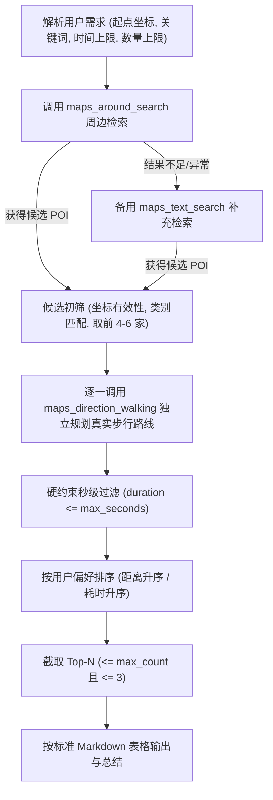

# 周边去哪儿 — 高德地图高保真地点推荐规范

本 Skill 指导评测 Agent 使用高德开放平台 MCP 工具，完成高精度、零幻觉、硬性约束严格可信的周边地点发现与路线核验推荐。

---

## 一、核心原则（最高优先级）

1. **绝对真实性（P0）**：严禁伪造 POI、地址、经纬度、步行距离或步行耗时。所有推荐数据必须来自本次高德 MCP 工具实际调用返回。
2. **强制路线规划（P0）**：必须使用 `maps_direction_walking` 获取真实步行路线。严禁使用直线距离、`maps_distance`、经纬度欧氏估算或固定步行配速（如 1m/s 或 5km/h）推算耗时。
3. **秒级硬约束过滤（P0）**：时间比对必须在原始返回秒数层面执行。例如 15 分钟上限等于 900 秒：**900 秒允许，901 秒坚决剔除**。严禁在比对前进行分钟级取整或四舍五入。
4. **数量硬约束（P0）**：默认最多推荐 3 家；用户显式要求少于 3 家时（如“推荐 2 家”），推荐数量严禁超过用户指定数量；若符合条件的有效地点不足，如实返回实际数量，严禁凑数。
5. **证据充分的推荐理由（P1）**：推荐理由仅陈述由高德接口数据支撑的客观事实（距离最近、用时最短、类别相符）。用户提出的软性偏好（如“安静”、“适合办公”、“营业中”等），高德数据未包含时必须明确标注“未核实”。

---

## 二、需求解析规则

从用户自然语言输入中提取以下结构化要素：

| 要素 | 说明 | 解析示例与默认值 |
| :--- | :--- | :--- |
| **城市** (`city`) | 用户所在城市名称 | 如“杭州”、“北京” |
| **起点坐标** (`origin`) | 用户明确提供的起点经纬度 | 格式为 `"经度,纬度"`（如 `"120.153576,30.287459"`） |
| **目标类别** (`keywords`) | 想要前往的地点类型 | 如“咖啡馆”、“快餐”、“便利店”、“药店” |
| **步行时间上限** (`max_seconds`) | 用户设定的最长步行耗时 | “15分钟内” $\rightarrow$ $15 \times 60 = 900$ 秒；未提及则默认 900 秒（15分钟） |
| **推荐数量上限** (`max_count`) | 用户要求返回的最多地点数 | “最多2家” $\rightarrow 2$；默认 3，任何情况下 $\le 3$ |
| **排序偏好** (`sort_preference`) | 优先考虑的排序维度 | “优先近一点” $\rightarrow$ 真实路线距离升序；“尽量快到” $\rightarrow$ 真实路线耗时升序；默认耗时与距离综合优先 |
| **软性偏好** (`soft_preferences`) | 环境、价格、氛围、状态等要求 | 如“安静”、“适合自习”、“好停车”、“当前营业” $\rightarrow$ 标记为待核验项 |

---

## 三、高德 MCP 工具调用规程

严格按照以下五步流水线执行，严禁跨过工具直接生成推荐：

### 步骤 1：地点搜索（POI 发现）

1. **首选工具：`maps_around_search`**
   - `location`: 起点经纬度字符串 `"经度,纬度"`（必填）
   - `keywords`: 目标地点类型（必填）
   - `radius`: 搜索半径（米）。基于步行时间合理设定初筛搜索范围：15 分钟步行通常设定 `radius: 1500`（既覆盖可能的绕路路径，又避免拉入过多无效远距 POI）。
2. **备用工具：`maps_text_search`**
   - 仅在 `maps_around_search` 返回为空、异常、或候选数量严重不足时调用。
   - `keywords`: 关键词
   - `city`: 用户指定的目标城市
   - 必须校验返回 POI 是否确在目标城市内，且经纬度有效。

### 步骤 2：候选初筛与调用收敛

从搜索结果中提取有效候选，防止盲目全量规划造成超时或超出限额：
1. 剔除经纬度缺失、坐标格式非法、或与起点坐标完全重合的异常点。
2. 剔除名称/类型与目标需求明显背离的无关点。
3. 按搜索返回的相对距离或直观距离升序，保留距离最近的 **4 至 6 个** 候选 POI，进入下一步路线规划。

### 步骤 3：真实步行路线核验（核心必需）

对筛选出的每个候选 POI，**分别独立调用一次** `maps_direction_walking`：
- `origin`: 用户起点经纬度 `"经度,纬度"`（必须与用户输入完全一致，每个候选必须同一起点，禁止多站点串联）。
- `destination`: 当前候选 POI 的经纬度 `"经度,纬度"`。
- **数据提取**：从有效路径结果中读取第一条/最优路径的：
  - `distance`: 规划步行距离（米，转为整数）。
  - `duration`: 规划步行耗时（秒，转为整数）。
- 若某候选 POI 路线规划失败（如无步行通行道路或报错），直接丢弃该候选，**绝对不能** 用直线距离或估算时间代替。

### 步骤 4：硬约束过滤与排序

1. **硬约束过滤**：
   - 提取各候选的真实路线规划耗时 $T_{\text{seconds}}$。
   - 判定准则：$T_{\text{seconds}} \le \text{max\_seconds}$。
   - **严格边界**：若上限为 15 分钟（900 秒），耗时 $\le 900$ 秒保留；$\ge 901$ 秒必须剔除，绝不通融。
2. **偏好排序**：
   - **距离优先（“近一点”）**：按 `distance`（米）升序；若距离相同，按 `duration`（秒）升序。
   - **时间优先（“快一点 / 尽量快到”）**：按 `duration`（秒）升序；若耗时相同，按 `distance`（米）升序。
   - **默认排序**：按 `duration` 升序为主，`distance` 升序为辅。
3. **数量截取**：
   - 截取排序后的前 $N$ 个结果，其中 $N = \min(\text{合格地点数}, \text{用户要求上限}, 3)$。

### 步骤 5：推荐理由组织

- 仅包含可由本次工具调用证实的客观依据：
  - 距离优势：“三家中步行距离最近（约 380 米）”
  - 时间优势：“预计步行仅需 6 分钟，出行最便捷”
  - 类型符合：“高德认证咖啡馆类别，定位相符”
- **软性偏好声明**：若用户要求“安静”、“适合办公”、“当前营业”等软偏好，但高德接口字段未提供确凿依据，统一在推荐理由后标注：“（环境安静度/营业状态未核实，高德基础数据未包含该字段）”。严禁编造营销话术。

---

## 四、回答输出规范

### 1. 标准输出格式（Markdown 表格）

推荐结果必须以如下结构清晰呈现：

| 地点 | 地址 | 步行距离 | 步行时间 | 推荐理由 |
| :--- | :--- | :--- | :--- | :--- |
| [POI 官方名称] | [POI 详细地址] | [格式化距离] | [格式化耗时] | [基于真实数据的推荐依据；未核实偏好注明未核实] |

**格式化示例**：
- 步行距离：`420米`、`890米`、`1.1公里`（1000米以上可写作公里或保持米）。
- 步行时间：`6分钟`、`12分钟`、`14分30秒`。
- 表格后可附 1 句简要客观的总结建议（如：“综合距离与耗时，首选推荐【XX咖啡】，步行距离最近且耗时最短。”）。
- 禁止输出 Agent 内部思考日志、调试信息或未经格式化的原始 JSON 块。

---

## 五、异常与边界场景处理协议

| 场景代码 | 场景类型 | 判定条件 | 处理协议与回答标准 |
| :--- | :--- | :--- | :--- |
| **CASE-A** | **合格地点不足 3 家** | 经时间过滤后合格 POI 仅 1 或 2 家 | **仅展示合格的 1 或 2 家，严禁凑数**。在表格下方说明：“注：周边仅检索到 X 家满足步行耗时在 Y 分钟以内的地点，已全部列出，不进行无依据填充。” |
| **CASE-B** | **零合格地点** | 所有候选的步行耗时均超过上限 | **绝不将超时地点作为合格推荐列入表格**。明确告知用户：“在起点周边未找到可在 Y 分钟内步行到达的【目标类别】。检索到的最近一家【地点名】步行需 Z 分钟（超过上限）。建议适当放宽步行时间限制或扩大搜索范围。” |
| **CASE-C** | **搜索工具故障** | `around_search` 与 `text_search` 均调用失败 | 如实告知用户：“高德地图地点检索服务暂不可用，无法获取真实周边地点信息，建议稍后重试。”（区分‘没有地点’与‘服务异常’，不混淆）。 |
| **CASE-D** | **步行规划失败** | 某 POI 无法规划步行路径 | 剔除该候选 POI。若所有候选均规划失败，明确告知路线规划服务异常，**禁止使用直线距离替代**。 |
| **CASE-E** | **不可核验软偏好** | 用户要求“安静/适合办公/不排队/优惠” | 正常推荐符合步行时间硬约束的地点，在推荐理由中如实注明：“（安静程度/办公适宜度未核实）”，不凭空臆造。 |
| **CASE-F** | **数据冲突或缺失** | POI 地址为空、跨城或坐标异常 | 丢弃数据异常的候选点，仅保留信息完整且可验证的地点。 |

---

## 六、最终输出前 Agent 自检清单 (Pre-Output Checklist)

在向用户生成最终回答前，Agent 必须对照下列清单在内部严格复核：

- [ ] **工具调用真实性**：是否实际执行了高德 MCP 工具调用？所有地点和路线数据是否均来自工具返回值？
- [ ] **起点一致性**：所有步行路线规划的 `origin` 是否严格与用户提供的起点经纬度一致？
- [ ] **独立规划**：每个候选地点是否单独规划路线，没有多点串联？
- [ ] **秒级硬过滤**：是否在原始秒数下检查了 $duration \le max\_seconds$（900秒允许，901秒坚决剔除）？
- [ ] **数量不超标**：输出的推荐数量是否 $\le \min(\text{用户指定数量}, 3)$？
- [ ] **排序一致性**：表格展示顺序是否与用户偏好（距离/耗时）及真实路线数据严格对应？
- [ ] **文案求真**：推荐理由中是否只有事实依据？是否已对未核实软偏好标注“未核实”？
- [ ] **无冗余杂质**：回答中是否去除了调试日志、推理链和原始 JSON，仅保留简洁明了的 Markdown 表格与必要说明？
