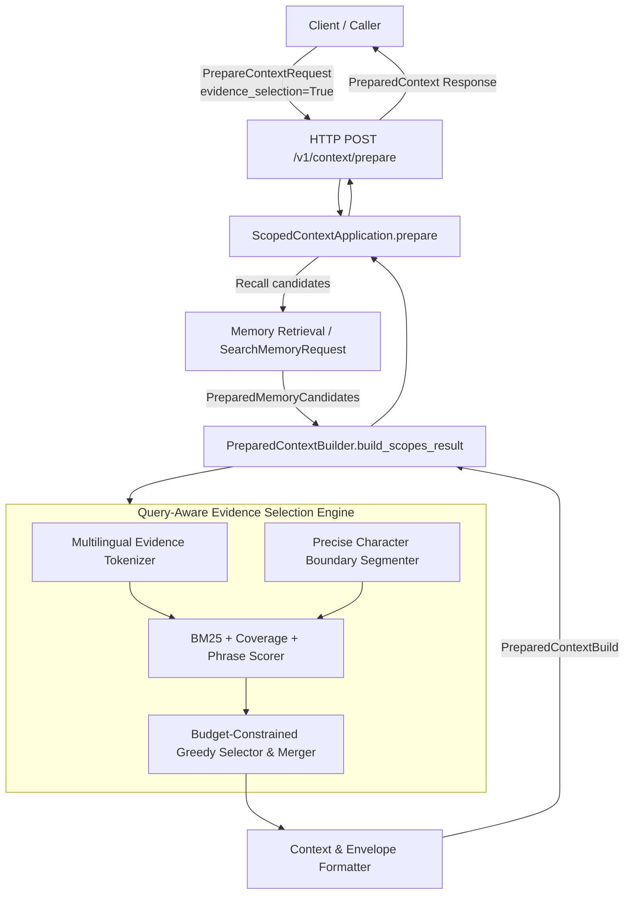
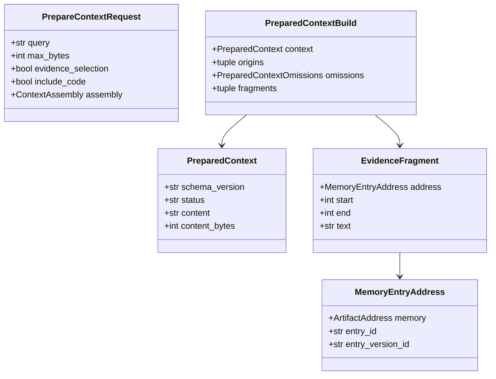

# PowerContext 赛题十：系统架构设计与交互模型

## 一、架构全景与组件职责

---

## 二、核心组件与数据流

### 2.1 候选召回与分流控制
- 在 `PreparedContextBuilder.build_scopes_result` 中进行模式分流：
  - 若 `request.evidence_selection is False`：走现有 `_select_entries` 逻辑，完全保留原有组装、排序、Topic Memory、Experience 和截断行为。
  - 若 `request.evidence_selection is True`：调用专用证据选择引擎 `_build_evidence_selection_result`。

### 2.2 多语言证据分词器（Tokenizer）
- 提取英文单词和数字（正则 `[a-z0-9]+`，小写化）。
- 提取 CJK 中文字符（正则 `[\u4e00-\u9fff]`）及相邻二元字符组合（CJK Bigram），使短语（如“海洋观测”）具备强相关匹配权重。
- 维护无歧义停用词表（`_STOPWORDS`），优先按内容关键词（Content Tokens）匹配，避免无意义功能词干扰打分。

### 2.3 精确字符边界切分器（Segmenter）
- 以英文句末标点（`.!?`）、中文标点（`。！？；`）和换行符为自然边界切分文本，记录每个候选句子在原文中的初始偏移。
- 通过单调向内收缩剔除前后多余空白字符，生成合法的非空半开字符区间 `[start, end)`。
- 直接以 `raw_text[start:end]` 获取正文，保证字符偏移量与切片文本完全一致。

### 2.4 证据效用打分引擎（Scorer）
结合以下维度计算候选片段得分：
1. **BM25 词频与逆文档频率**：以全部候选片段统计动态词频与逆文档频度（$IDF$），惩罚高频词，突出特有实体词。
2. **查询覆盖率加权（Coverage Multiplier）**：对覆盖更多查询内容词的句子赋予指数级加权，避免单一词项重复带来的误报。
3. **精准短语匹配（Phrase Boost）**：若片段包含完整查询短语或二元短语，赋予额外强相关性加分。
4. **数字实体加权（Numeric Boost）**：针对数字、温度、阈值等高辨识度实体给予权重增强。
5. **候选文档初检先验（Doc Prior）**：根据检索模块返回的初检次序，为靠前的候选赋予平滑基础分。

### 2.5 预算约束下的贪心选择与相邻片段合并（Merger & Selector）
- 对候选片段按效用得分倒序排序。
- **相邻/重叠合并策略**：若新入选片段与同条 Memory entry 中已入选的片段相交、相邻或仅间隔空白/标点符号，将其合并为单一连续区间 `[min(start1, start2), max(end1, end2))`。
  - **收益**：既扩大了官方标注证据的覆盖区间，又消除了额外 item 的 JSON 引用元数据开销（每个 item 节省约 160-200 字节）。
- **零超预算硬保证**：每次入选或合并前，均调用 `_render_evidence_envelope` 动态序列化为标准 envelope，严格测量真实 UTF-8 编码字节数。若超出 `request.max_bytes` 则拒绝加入。
- **空结果安全兜底**：当无相关证据或极小预算无法容纳任何合法 item 时，返回 `status="empty", content=None, content_bytes=0`。

---

## 三、类与结构体设计

