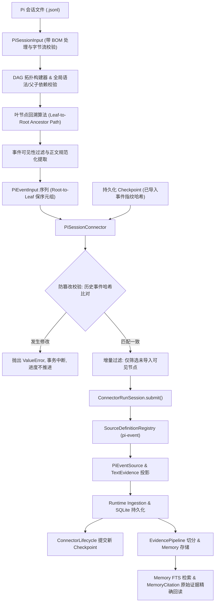

# 赛题三：Pi 会话分支采集与断点恢复 - 架构与系统设计

## 一、系统架构总览

PowerContext 作为面向长任务与自主 Agent 的上下文管理引擎，通过统一的 Source、Connector 与 Memory 机制实现多源数据的标准化摄入、持久化与溯源。

针对 Pi 助手的会话分支历史采集需求，本设计构建了基于 DAG 拓扑追溯、规范化文本证据投影以及 ConnectorLifecycle 事务性断点的分层架构：



---

## 二、核心组件与协议设计

### 1. 会话图谱拓扑构建与分支还原 (`parse_pi_session`)

Pi 会话格式以树/森林组织会话历史，通过各节点的 `parentId` 形成父子关系。
- **解析器设计原则**：
  1. **首行强制约束**：第一条记录严格核对 `type="session"`、`version=3` 与非空 `id`。
  2. **严格单向 DAG 校验**：每一条后续记录在插入前，其 `parentId` 必须为 `None` 或已经存在于 `seen_ids` 集合中。这在常数级时间内消除了前向引用、自环和潜在循环依赖。
  3. **叶节点智能选择**：当未显式指定 `leaf_id` 时，自动采用会话文件中的物理末尾节点，与真实编辑器工作流对齐。
  4. **拓扑回溯与反转保序**：从目标叶节点不断迭代其 `parentId` 爬取至根节点，检测循环依赖后进行反转，输出严格自根至叶的时间拓扑序 `tuple[PiEventInput, ...]`.

### 2. 事件正文格式化与证据提取规则

为满足后续语义检索（FTS）与精准证据回查，本模块实现了一致的结构化正文投影器：

```
+-----------------------------+-----------------------------------------------------------+
| 事件类型                    | 格式化输出 (ROLE: BODY)                                   |
+-----------------------------+-----------------------------------------------------------+
| 普通 message (text 块)       | <role>: <text_line1>\n<text_line2>                        |
| message 含 toolCall 块       | assistant: [tool_call <name> <id>] <compact_json_args>    |
| role=toolResult             | toolResult: [tool_result <name> <id>] <result_text>       |
| role=bashExecution          | bashExecution: $ <command>\n<output>                      |
| compaction / branch_summary | <event_type>: <summary>                                   |
| custom_message              | custom: <visible_text>                                    |
+-----------------------------+-----------------------------------------------------------+
```
- **关键细节**：
  - JSON 参数使用 `json.dumps(args, ensure_ascii=False, sort_keys=True, separators=(',', ':'))` 确保跨平台紧凑无空格并保持键排序与 Unicode 原文。
  - 过滤控制节点（如 `model_change`, `thinking_level_change`）、`thinking` 内部私有推理过程以及 `image` 多模态数据，控制节点只继承拓扑连接关系，不产生虚假文本证据。

### 3. 不可变 Source 与稳定 Identity

- **标识生成公式**：
  $$\text{identity} = \text{pi}:\{\text{session\_id}\}:\{\text{event\_id}\}$$
- **稳定性与防碰撞**：
  - 完全由 `session_id` 与 `event_id` 两元组唯一确定，长度严格受限在 256 字符之内。
  - 无论何时何地重新解析同一会话的同一事件，生成的 `source.name` 与 `source.source_id` 始终绝对恒定。
  - 当外部尝试篡改该事件的内容重新摄入时，底层 `Runtime ingestion` 依托该恒定 identity 触发 `SourceConflictError`，实现强一致性的不可变写入语义。

### 4. 增量采集、Checkpoint 状态机与断点恢复

- **Checkpoint 内部数据模型**：
  ```json
  {
    "version": 1,
    "events": {
      "root": "7a3b4c...",
      "left": "9d8e1f..."
    }
  }
  ```
  键为已导入的 `event_id`，值为该事件完整原始 JSON 记录的规范化 SHA-256 指纹。
- **状态机与操作语义**：
  1. **读取上一进度**：通过 `ConnectorRunSession.checkpoint` 加载先前已提交的进度字典。
  2. **历史防改写扫描**：遍历文件内当前出现的所有记录，若某记录的 `id` 存在于 `known_events` 中，计算其实际指纹并与已持久化指纹比对。若不匹配，立即抛出 `ValueError`。
  3. **增量提交流程**：仅对当前选定分支路径上尚未记录在 `known_events` 中的事件调用 `session.submit(event.event_id, "pi-event", event)`。
  4. **提交与断点推进**：所有新增事件提交成功后，组装包含全部历史与当前新增事件的新 checkpoint。只有在所有提交均成功完成且无 REJECTED/FAILED 时，`ConnectorLifecycle` 才会调用底层存储提交新进度。
  5. **故障恢复**：若解析中断、写入失败或中途崩溃，旧 checkpoint 保持不动。修复输入或重试时，自动从上一次成功的 checkpoint 平滑恢复。
